# Interval Trainer

A work/rest interval timer (Tabata style) for Zepp OS watches. Set the work time, rest time and number of rounds, start, and the watch counts you down with a clear sound and vibration before every phase change.

Why another timer: the interval apps tried from the Zepp store vibrate too faintly and cannot play a sound. This one keeps the app open with the screen on during the session, which on the Amazfit GTR 4 is what makes sound and strong vibration possible.


## Features

- Configurable work (6 s to 60 min), rest (6 s to 60 min) and rounds (1 to 99)
- 5 s get-ready countdown before the first work phase
- A beep countdown that ends exactly on every phase change, the start and the finish
- Strong vibration at 5, 4, 3, 2 and 1 seconds before each change
- Screen kept on for the whole session
- Pause, resume and stop with confirmation
- Local presets, auto-named from their values (for example `60/15 x 5`)
- Settings: sound, vibration and the 5-1 s vibration can each be switched off
- Round (GTR 4) and square (GTS 4) layouts
- Fully offline, no phone companion app required

See the [roadmap](docs/specs/05-roadmap.md).

## Default session

`60 s work / 15 s rest x 5 rounds`, with no rest after the last round: 6:00 in total.

```mermaid
gantt
    dateFormat ss
    axisFormat %M:%S
    section Session
    Work 1 :w1, 00, 60s
    Rest   :r1, after w1, 15s
    Work 2 :w2, after r1, 60s
    Rest   :r2, after w2, 15s
    Work 3 :w3, after r2, 60s
    Rest   :r3, after w3, 15s
    Work 4 :w4, after r3, 60s
    Rest   :r4, after w4, 15s
    Work 5 :w5, after r4, 60s
```



## How it works

- **Deadline-based timing.** A session stores absolute timestamps, never a decrementing counter, so the display and alerts cannot drift.
- **Foreground session.** The session page keeps the screen on and runs a tick just after every whole session second (measured 5-18 ms late on the GTR 4). Each tick works out the current phase and the due alert from the stored deadlines.
- **No duplicate or stale alerts.** If a tick is late, only the latest due alert is played (within a 2 s grace window). Old warnings are never replayed.
- **Why not background alerts.** Alarms that wake a background service were tested first: on the GTR 4 their vibration was almost imperceptible, sound did not play and alarms got lost. The measurements are in [docs/test-reports](docs/test-reports/).

Details are in the [architecture spec](docs/specs/02-architecture.md).

## Known limitations

- The app must stay open during a session; closing it ends the alerts. If the screen turns off, the app does not come back when the wrist is raised.
- First soak: battery 53% to 51% over approximately 30 minutes with sound and vibration on; all alerts retained their intensity. An always-on watch-face reference used approximately 0.5 percentage points, but the display modes differ. This single run is not a precise battery-life estimate. See the [report](docs/test-reports/2026-10-03-b3-spike-short-session.md#production-session-soak-follow-up-2026-10-12).

## Supported devices

| Device | Screen | Status |
|---|---|---|
| Amazfit GTR 4 | Round 466 x 466 | Primary target, Zepp OS 3.5 (API level 3.5) |
| Amazfit GTS 4 | Square 390 x 450 | Tested by the maintainer; no apparent problems (2026-10-12) |

The app uses no API above level 3.5.

## Status

| Milestone | State |
|---|---|
| Tooling, simulator and project scaffold | Done |
| Pure interval engine with unit tests (`lib/`) | Done |
| Hardware tests on the watch: alerts, sound, keep-screen-on | Foreground approach chosen; final runs in progress |
| Audio with bundled MP3 | Done (works from the open app) |
| Storage for presets and session recovery | Done |
| Screens: presets, editor, session, result, settings | Done (tested on the GTR 4) |
| Release 1.0 | Submitted to the Zepp Store (confirmed 2026-10-12) |

Live status and decisions: [docs/PLAN.md](docs/PLAN.md).

## Getting started

### Prerequisites

- [Node.js](https://nodejs.org/) (developed and tested with Node 24)
- [Zeus CLI](https://docs.zepp.com/docs/guides/tools/cli/): `npm i -g @zeppos/zeus-cli`
- [Zepp OS Simulator](https://docs.zepp.com/docs/guides/tools/simulator/) with the Amazfit GTR 4 device, for running in the simulator
- The Zepp app with Developer Mode enabled, for installing on a watch

### Commands

```bash
npm install        # install dev dependencies
npm test           # run the unit tests (node:test, no simulator needed)
npm run dev        # run in the Zepp OS Simulator (zeus dev)
npm run preview    # install on a watch via QR code (zeus preview)
npm run build      # build the package into dist/ (zeus build)
```

More setup notes and troubleshooting: [docs/DEV-SETUP.md](docs/DEV-SETUP.md).

## Project structure

```
app.js, app.json   app entry and Zepp OS configuration
lib/               pure logic (no @zos imports), unit-tested
page/gt/           watch pages with round (.r) and square (.s) layouts
utils/             Zepp adapters (alerts: vibration and sound)
assets/gt.r, gt.s  resources per screen shape (images, audio)
tests/             *.test.mjs, run with node --test
docs/              plan, specs, setup and hardware test reports
```

## Documentation

- [Product spec](docs/specs/01-product.md): configuration, session flow, alerts, recovery rules
- [Architecture](docs/specs/02-architecture.md): data model, reconciliation, alarm window, API register
- [Session screen](docs/specs/03-session-screen.md): layouts and behavior
- [Hardware gate](docs/specs/04-hardware-gate.md): what must be proven on the watch
- [Roadmap](docs/specs/05-roadmap.md)

## License

[ISC](LICENSE) © 2026 Hugo Apolónio
